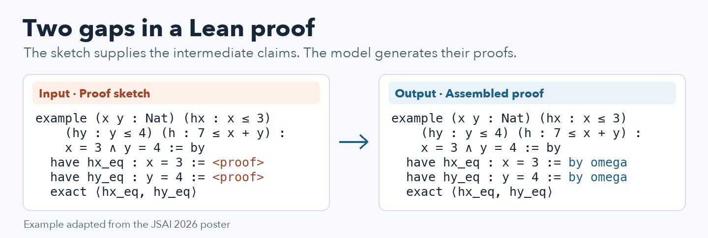
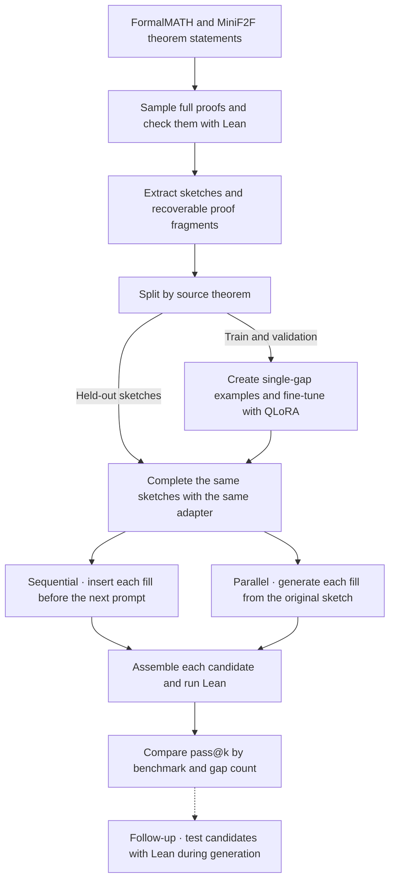
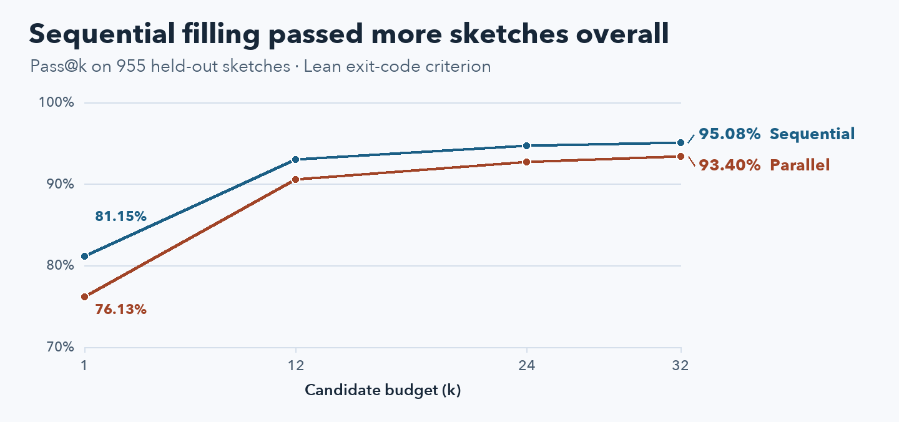

# SketchFill · Automated gap-filling in Lean 4 proofs

**Junyang Pan** · Undergraduate research, Tokyo University of Science

[JSAI 2026 paper](https://doi.org/10.11517/pjsai.JSAI2026.0_4YinA45) · [Conference poster](docs/figures/jsai-2026-poster.pdf) · [Reproduce the study](#reproduce-the-study)

## Research question

A formal proof sketch gives Lean the theorem statement and the intermediate claims to prove, with some proof fragments missing. Can a language model fill those gaps while preserving the proof's structure? When there are several gaps, does showing the model its earlier completions improve the chance of obtaining a complete proof?

I investigated these questions for my undergraduate thesis. I built a dataset of Lean sketches paired with the original fragments, fine-tuned DeepSeek-Prover-V2-7B for single-gap completion, and implemented a Python pipeline to assemble and check generated proofs. I then compared two ways to handle dependencies between gaps on the same held-out sketches. I presented the work at JSAI 2026 and co-authored the paper with Takuya Matsuzaki.

**Main result.** Sequential filling reached **95.08% pass@32** on 955 held-out sketches, compared with **93.40%** for independent filling. The advantage was larger on sketches with multiple gaps, and MiniF2F favored independent filling at higher attempt budgets. These scores use the original Lean exit-code criterion. [Results and verification details](#5-evaluate-the-completed-proofs)



## How the experiments fit together



### 1. Formulate a local completion task

Draft, Sketch, and Prove uses a partial formal proof as an intermediate representation. I focused on its completion stage. The model receives the Lean imports, theorem statement, and surrounding sketch. Its job is to output the Lean code for the one gap marked `<proof>`, ending the fragment with `<eofill>`. This gives the model an explicit target and gives the inference code a boundary for extracting the response. Lean's `sorry` serves as a temporary placeholder for other gaps that have yet to be filled.

This formulation lets the same model handle a sketch with one gap or a sketch with many gaps. The inference program decides which gap to present next and how to use earlier completions. That decision became the variable I tested in the paired experiment. [Draft, Sketch, and Prove](https://arxiv.org/abs/2210.12283) · [Prompt and tokenizer implementation](src/train_stepwise_sft.py)

### 2. Build and validate the data

I sampled ten complete proof candidates per source theorem with the pretrained prover and used Lean to screen them. I then extracted sketches from accepted proofs by masking the right-hand sides of intermediate claims, including inline proof terms and indented tactic blocks. I retained the removed fragments in order. Replacing each marker with its corresponding fragment had to recover the source proof, which gave me a way to detect broken masking and mismatched labels before training.

| Benchmark | Generated proofs | Passed the Lean screening step | Extracted sketches | Source theorems represented |
| --- | ---: | ---: | ---: | ---: |
| FormalMATH | 55,600 | 5,980 | 3,616 | 563 |
| MiniF2F | 4,880 | 2,850 | 1,842 | 260 |
| **Total** | **60,480** | **8,830** | **5,458** | **823** |

The 5,458 sketches averaged 2.66 gaps. I checked that the number of markers matched the number of saved fragments. An audit of the archived corpus also recovered all 5,458 proof bodies after trimming outer whitespace. The published paper reports the original sampling and screening counts. [Sketch construction notebook](notebooks/sketch-FormalMATH.ipynb) · [Derived corpus](data/Final_sketchdata.jsonl.gz) · [Paper](https://doi.org/10.11517/pjsai.JSAI2026.0_4YinA45)

Multiple candidate proofs can come from the same theorem, so splitting individual sketches at random could put different versions of one problem on both sides of the evaluation. I assigned splits using the benchmark and source theorem ID, then expanded each training or validation sketch into one example per gap. The other gaps in each training example were represented by `sorry`. Test sketches kept their full gap structure so the evaluation could measure whether all the fragments worked together.

| Split | Sketches | Source theorems | Single-gap training or validation examples |
| --- | ---: | ---: | ---: |
| Train | 4,191 | 639 | 11,102 |
| Validation | 312 | 45 | 835 |
| Test | 955 | 139 | — |

The archive check found zero source-key overlap across these splits. The rates below are measured per sketch. A theorem with several sketches can contribute several cases. [Training data notebook](notebooks/holewise_training.ipynb) · [Split and archive checks](docs/verify_archive.py)

### 3. Train a single-gap prover

I adapted the existing **DeepSeek-Prover-V2-7B** model with supervised fine-tuning and QLoRA. I registered the gap and end markers with the tokenizer, used 4-bit NF4 quantization for the base model, and applied trainable LoRA adapters to attention and feed-forward projections. I saved the matching tokenizer, training configuration, and validation logs so the adapter could be loaded with the same input format later.

| Training setting | Recorded value |
| --- | --- |
| Base model | DeepSeek-Prover-V2-7B |
| Quantization and compute | 4-bit NF4 with bfloat16 compute |
| LoRA | Rank 32, alpha 64, dropout 0.05 |
| Learning rate and maximum sequence length | 0.0002 and 8,192 tokens |
| Run length | 1 epoch, 463 optimizer steps |
| Validation mean token accuracy | 93.09% |

Validation token accuracy measures predictions at the token level. Whole-proof success was evaluated separately by running Lean on assembled candidates. [Training script](src/train_stepwise_sft.py) · [Run configuration](configs/run_config.json) · [Training log](results/log_history.json) · [Validation metrics](results/metrics_eval.json)

### 4. Compare two ways to fill multiple gaps

I used the same trained adapter, test sketches, and candidate budget for both methods. One attempt generated a fragment for each gap and assembled one complete candidate. I varied whether the next prompt could see the fragments already generated during that attempt.

| Method | What the model sees when filling a later gap |
| --- | --- |
| **Sequential** | The sketch with earlier fragments already inserted, one current gap marked `<proof>`, and remaining gaps represented by `sorry`. |
| **Parallel** | The original sketch with only the selected gap marked `<proof>`. The other gaps are represented by `sorry`, and the fragments are inserted together after generation. |

I separated generation, assembly, and verification so each stage could be inspected on its own. The generation scripts distribute work across GPU workers and record seeds, sketch IDs, attempt indices, and gap indices. The assembler groups fragments by sketch and attempt and checks their indices before rebuilding the Lean file. The verifier runs `lake env lean` on each candidate and records the exit status, timing, and diagnostics. [Sequential generator](src/generate_sequential.py) · [Parallel generator](src/generate_parallel.py) · [Assembler](src/assemble_holes.py) · [Lean verifier](src/run_lean_verify.py)

### 5. Evaluate the completed proofs

Each method produced **32 attempts for each of 955 test sketches**, for **30,560 attempts per method**. Pass@k is the share of sketches with at least one successful Lean exit among the first *k* candidates. A candidate counts as one attempt only after the generated fragments are assembled into a single proof file.



| Method | Pass@1 | Pass@12 | Pass@24 | Pass@32 |
| --- | ---: | ---: | ---: | ---: |
| Sequential | 775/955 (81.15%) | 888/955 (92.98%) | 904/955 (94.66%) | **908/955 (95.08%)** |
| Parallel | 727/955 (76.13%) | 865/955 (90.58%) | 885/955 (92.67%) | 892/955 (93.40%) |

| Test subset | Sketches | Sequential / parallel at pass@1 | Sequential / parallel at pass@32 |
| --- | ---: | ---: | ---: |
| One gap | 375 | 86.40% / 86.40% | 98.93% / 98.93% |
| Multiple gaps | 580 | **77.76%** / 69.48% | **92.59%** / 89.83% |
| FormalMATH | 621 | **80.03%** / 73.75% | **95.97%** / 92.75% |
| MiniF2F | 334 | **83.23%** / 80.54% | 93.41% / **94.61%** |

The multi-gap subset showed the largest first-attempt gain. The methods had the same scores on one-gap sketches, where the question of earlier context disappears. The MiniF2F reversal at higher *k* suggests that the choice of inference method depends on the benchmark and the candidate budget. One hypothesis is that a plausible but incorrect early fill can steer later predictions. The comparison measures the effect of the two generation procedures, and tracing individual failures would be needed to establish that mechanism. [Analysis notebook](notebooks/Results-Analyse.ipynb) · [Archived result counts](results/summary.json)

**What Lean accepted.** The original metric uses a zero process exit code. Lean can return that code for a declaration with a `sorry` warning. A recount that excludes attempts with a *recorded* `sorry` warning gives **864/955 (90.47%)** for sequential and **843/955 (88.27%)** for parallel at *k* = 32. The warning flag comes from saved diagnostic tails, which can be truncated. Establishing that a declaration is free of `sorry` would require checking its axioms. [Verification notes and attempt logs](docs/results.md#completed-comparison)

### Follow-up · Run Lean during generation

I also tested whether Lean could screen fragments before I carried them into later prompts. The generator tried multiple candidates at the current gap, compiled the partial sketch, and inserted the first passing fragment. It stopped the current attempt when no candidate passed. The run recorded **23,789 candidate checks** across **1,986 gap records**, including **13,831 successful exits** on partial sketches.

The assembly log recorded 739 of 955 groups with all expected indices and skipped 216 groups with missing indices. On inspection, nine of the 739 assembled records contained an empty final fill. This leaves **730 records with a nonempty fill at every gap**. The saved evidence covers partial candidate checks and assembly. To estimate whole-proof success for this one-attempt experiment, replay the assembled files in Lean and count successes over all 955 input sketches. [Lean-filtered generator](src/generate_lean_filtered.py) · [Follow-up logs and assembly notes](docs/results.md#latest-lean-filtered-run)

## Repository contents

| Keep in the repository | What a reader can inspect |
| --- | --- |
| [Python scripts](src/) and [research notebooks](notebooks/) | Data construction, training, generation, verification, and analysis. The notebooks retain the experimental code with execution outputs cleared. |
| [Lean project](lean/) and [model configuration](configs/) | Pinned Lean and Mathlib revisions, training settings, tokenizer, and the receipt that identifies the original adapter weights. |
| [Derived data](data/) and [saved results](results/) | Compressed training and test splits, candidate proof code and attempt verdicts, summary counts, and selected training metrics. |
| [Documentation and figures](docs/) and [earlier experiments](history/) | Conference material, reproduction commands, source provenance, and compact evidence of the project’s development. |

Keep raw proof dumps, server-only data, adapter weights, checkpoints, local credentials, and new run outputs in local or research storage. The reproduction commands write new files under `work/`. The ignore rules also cover environments, Lean build products, and caches. [Ignore rules](.gitignore) · [File-level provenance](docs/source-manifest.json) · [Third-party notices](docs/third-party-notices.md)

## Reproduce the study

### 1. Recalculate the reported results from the archive

From the repository root, run the command below with Python 3. It uses the standard library and the committed files. It verifies file hashes and row counts, checks for overlap by benchmark and source ID, confirms that both methods evaluated the same cases, and recomputes pass@k for 1, 12, 24, and 32 attempts. The expected pass@32 numerators are **908** and **892**.

```sh
python3 docs/verify_archive.py
```

### 2. Recheck saved proofs with Lean

Install Elan, then prepare the pinned Lean 4.15.0 project. The example below rechecks five saved first attempts from the sequential experiment. It uses the Lean code already stored in the archive, so it runs on a CPU without model weights.

```sh
(cd lean && lake exe cache get && lake build)
mkdir -p work/replay
python3 - <<'PY'
import gzip
import json
from itertools import islice

with gzip.open("results/sequential-verified-attempts.jsonl.gz", "rt", encoding="utf-8") as source:
    first_attempts = (line for line in source if json.loads(line)["gen_attempt"] == 0)
    with open("work/replay/sample.jsonl", "w", encoding="utf-8") as output:
        output.writelines(islice(first_attempts, 5))
PY
LEAN_PROJ="$PWD/lean" GEN_JSONL="$PWD/work/replay/sample.jsonl" \
OUT_JSONL="$PWD/work/replay/verify_results.jsonl" JOBS=2 \
python3 src/run_lean_verify.py
```

The new verdicts and compiler messages are written to `work/replay/verify_results.jsonl`. For a full replay, extract both saved attempt ledgers and pass each to the verifier. [Full replay and aggregation commands](docs/reproduce.md#replay-the-completed-comparison)

### 3. Generate new candidates or train a fresh adapter

Extract the archived splits into `work/data/`, prepare a compatible CUDA/PyTorch environment, and restore the archived tokenizer with its adapter configuration. To generate with the original adapter, obtain the weights from the research storage and verify their SHA-256 against the receipt. With access to a compatible GPU environment, another route is to train a fresh adapter from the released single-gap examples and repeat the comparison. A fresh run can produce different candidate proofs and scores.

The full guide gives the commands for training, generating both methods, assembling the outputs, running Lean, and computing pass@k. It also documents the separate experiment with per-gap Lean checks. [Full reproduction guide](docs/reproduce.md) · [Original adapter receipt](configs/final-adapter-receipt.json)

**Research references** · [Draft, Sketch, and Prove](https://arxiv.org/abs/2210.12283) · [DeepSeek-Prover-V2-7B](https://huggingface.co/deepseek-ai/DeepSeek-Prover-V2-7B) · [FormalMATH](https://github.com/Sphere-AI-Lab/FormalMATH-Bench) · [MiniF2F](https://github.com/facebookresearch/miniF2F)
